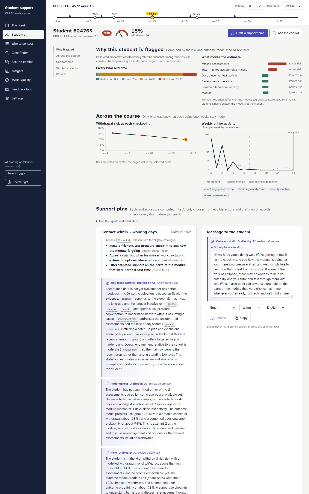

# Student Success Assistant — v6

An early-warning and student-support microservice built on the complete Open University Learning Analytics Dataset
(OULAD). At several points in a course it finds students **who are still enrolled** and likely to withdraw or fail,
explains why, shows what happened to similar students from earlier cohorts, ranks who to contact first under limited
advisor capacity, and drafts a supportive plan and message that an advisor reviews. A copilot answers questions by
calling the same tools, every AI feature is evaluated, and advisor feedback flows back through approval-gated updates.

**Stack:** Python 3.12 (pandas, XGBoost with TreeSHAP), LanceDB vector store, sentence-transformers (e5-small-v2),
LangGraph agent workflow, Claude through the Anthropic API (Haiku / Sonnet / Opus by task; everything has a computed
fallback), FastAPI + uvicorn, React 19 + TypeScript console (Vite, TanStack Query/Table, Radix, Recharts), SQLite for
feedback, usage and evaluation records, DeepEval and RAGAS for AI evaluation.



## Quick start

```bash
python -m venv .venv && source .venv/bin/activate
pip install -r requirements.lock               # exact pins (Linux: add --extra-index-url https://download.pytorch.org/whl/cpu); requirements-core.txt = no LLM / DeepEval / embeddings
cp .env.example .env                          # set STUDENT_ASSISTANT_API_KEY; ANTHROPIC_API_KEY for AI features (Claude)
unzip OULAD_Dataset.zip -d data/raw           # the 7 OULAD CSVs (see data/README.md)
make build                                    # 4 checkpoints: features, models, indexes, evaluation, LLM eval, gate, report (~12 min)
make api                                      # FastAPI on http://127.0.0.1:8000  (docs at /api/docs, console at /)
```

The repository ships a prebuilt console in `frontend/dist`, which the API serves at `/`. To work on the frontend:
`make web-install && make web-dev` (Vite on :5173, proxying `/api` to :8000). `make web-build` rebuilds `dist/`.

In the console open **Settings** and paste the API key. Docker: `docker compose run --rm build`, then `docker compose up app`.
No dataset yet? `make demo` builds everything on a small synthetic fixture (clearly marked non-official).

Extra evaluations (each writes an artifact the model card reads):

```bash
python -m ssa.cli llm-eval            # every AI feature: code checks, LLM judge, A/B, DeepEval, copilot, adversarial prompts (LLM_BUDGET_USD caps spend)
python -m ssa.cli embedding-eval      # five sentence-embedding models on the same narratives: accuracy, speed, size
python -m ssa.cli llm-compare         # the same features on Haiku, Sonnet and Opus: quality, cost, latency
python -m ssa.cli retrieval-study     # top-K, candidate pool and RRF sensitivity
.venv-ragas/Scripts/python scripts/ragas_eval.py   # RAGAS, in its own environment (see requirements-ragas.txt)
python -m ssa.cli report              # regenerate docs/MODEL_CARD.md and the deck from the artifacts
```

## What's in it

| Area | What it does |
|---|---|
| Data | All 7 tables: demographics, registrations, tutor- vs computer-marked assessments, VLE clicks by activity type, the planned teaching schedule, and complete historical records (whole-course activity, withdrawal week, coursework and exam results) |
| Checkpoints | Separate calibrated models, indexes and rankings at ~week 6, 9, 15 and 22; the console's course clock switches between them |
| Risk | Withdrawal model (students still enrolled only), four-class outcome model, learned Medium/High tiers, TreeSHAP drivers |
| Retrieval | Supervised behavioural kNN + BM25 over descriptive signals + dense narrative embeddings, weighted RRF; vectors in LanceDB with metadata pre-filtering (course, region, education, age band, credits, previous attempts); earlier cohorts only; "what happened next" stories |
| Prioritisation | Weights learned for precision at advisor capacity (one-standard-error blend), reason codes |
| Agents | LangGraph workflow: performance → risk → router → intervention ⇄ critic, with live progress, an eligible-action catalogue and code guardrails ([graph](docs/AGENT_GRAPH.md)) |
| LLM features | Copilot with tool use over 8 tools, streamed; search understanding; precedent synthesis; cohort briefing; outreach rewrite by channel, tone and language; feedback note themes; judge on demand and sampled online |
| Evaluation | Temporal test, calibration, baselines, ablations, fairness with permutation tests, retrieval vs random, embedding-model comparison, LLM-tier comparison, and per-feature AI evaluation: code checks, LLM-as-judge, order-swapped A/B, DeepEval, RAGAS, blind human review in the console, usage and cost |
| Security | API and admin keys, strict validation, prompt-injection screen, output guardrails, sensitive attributes never used or sent ([details](docs/SECURITY.md)) |
| Feedback | Registered recommendations, per-action and per-precedent labels, real outcomes, learners with admin approval, drift monitors |

## Results

All figures are generated from the build artifacts: [`docs/MODEL_CARD.md`](docs/MODEL_CARD.md) (regenerated by
`make report`) covers the models at each checkpoint, retrieval and typed search, the embedding and LLM comparisons,
RAGAS, DeepEval, the judge, fairness and the quality gate. `docs/reference_run/` keeps the earlier scikit-learn baseline.

## Layout

```
ssa/                 Python package (see docs/ARCHITECTURE.md)
  data/  models/  retrieval/  agents/  evaluation/  feedback/  api/  service.py  appdb.py  reporting.py  cli.py
frontend/            React console (src/, prebuilt dist/, DESIGN.md)
scripts/             architecture diagram, lock file, RAGAS runner
tests/               pytest on an isolated synthetic fixture (no network, no LLM)
docs/                architecture, design, decisions, security, API, deployment, model card, PRD traceability, deck, screenshots
```

## Documentation

[Architecture](docs/ARCHITECTURE.md) · [Design](docs/DESIGN.md) · [Design decisions](docs/DECISIONS.md) ·
[Agent graph](docs/AGENT_GRAPH.md) · [Security and compliance](docs/SECURITY.md) · [Console design](frontend/DESIGN.md) ·
[API](docs/API.md) · [Deployment](docs/DEPLOYMENT.md) · [Model card](docs/MODEL_CARD.md) ·
[PRD traceability](docs/PRD_TRACEABILITY.md) · [Audit fixes](docs/AUDIT_FIXES.md) ·
[Deck](docs/Student_Success_Assistant_10min.pptx) · [Presentation script](docs/PRESENTATION_SCRIPT.md)
