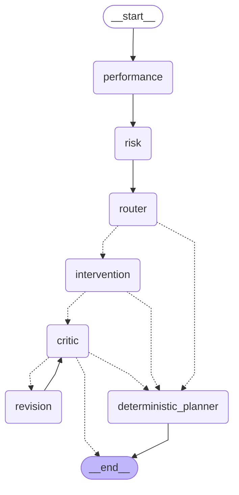

# Support workflow graph (LangGraph)

Generated from `ssa.agents.graph` (`python -c "from ssa.agents.graph import mermaid; print(mermaid())"`). Nodes call the
workflow's own agents; every LLM output is validated in code and has a deterministic fallback. `WORKFLOW_ENGINE=python`
runs the same steps without LangGraph; `tests/test_graph.py` checks both give identical results on every path.

| Node | Role | LLM | Fallback |
|---|---|---|---|
| performance | summarise strengths and concerns from observation IDs | main tier | observations verbatim |
| risk | narrate calibrated risk, drivers, precedents, uncertainty | main tier | templated from model outputs |
| router | intervene or monitor (tier, P(fail or withdraw), number of concerns) | no | rule in code |
| intervention | choose 2-4 eligible actions, outreach message, rationale citing observation IDs | main tier | deterministic planner |
| critic | validate IDs, eligibility, message length, protected / punitive / clinical / stigma terms, numbers | no | one revision request, then fallback |
| revision | the intervention agent again, given the critic's violations | main tier | deterministic planner |
| deterministic_planner | catalogue-gated plan from eligible actions | no | (is the fallback) |
