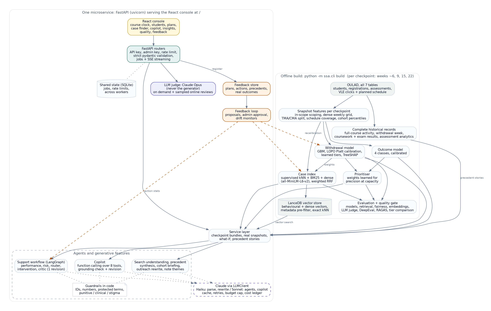

# Architecture



Source: [`architecture.dot`](architecture.dot) (render with `python scripts/render_architecture.py`; SVG in `architecture.svg`).

## Offline build — `python -m ssa.cli build`

Every stage runs once per checkpoint (`CHECKPOINTS`, default 0.15/0.25/0.40/0.60 of the planned course length;
artifacts in `artifacts/checkpoints/c15…c60`). Course-level records (complete historical activity and results,
assessment analytics, engagement trends) are built once.

| Stage | Module | Output |
|---|---|---|
| Snapshot features | `ssa.data.pipeline` | `data/processed/student_features.csv.gz`, `weekly_engagement.npz`, course trends |
| Withdrawal model | `ssa.models.risk` | `artifacts/models/withdrawal_model.joblib` (engine, Platt calibrator, tier thresholds, reference stats) |
| Outcome model | `ssa.models.outcome` | `outcome_model.joblib` (class-weighted GBM, prior correction, temperature) |
| Prioritiser | `ssa.models.prioritization` | `prioritization.json` (weights learned on validation) |
| Case index | `ssa.retrieval.hybrid`, `ssa.retrieval.vector_store` | `artifacts/checkpoints/<c>/index/`: `vectors.lance` (LanceDB table: behavioural + dense vectors with filterable metadata), descriptors and narratives, manifest, tuned fusion weights |
| Evaluation | `ssa.evaluation.*`, `ssa.retrieval.benchmark` | `artifacts/metrics/*.json`, `artifacts/analysis/*.json` |
| AI evaluation | `ssa.evaluation.offline_eval` (`llm-eval`), `model_comparison` (`llm-compare`), `embedding_eval` (`embedding-eval`), `scripts/ragas_eval.py` (own environment) | `llm_evaluation.json`, `model_comparison.json`, `embedding_eval.json`, `ragas_eval.json`, `rag_cases.jsonl`, `human_labels.jsonl` |
| Agent orchestration | `ssa.agents.graph` (LangGraph state graph over the agents in `ssa.agents.workflow`) | `docs/AGENT_GRAPH.md` |
| Quality gate | `ssa.cli.quality_gate` | `artifacts/metrics/quality_gate.json` (thresholds, not file existence) |
| Reports | `ssa.reporting` | `docs/MODEL_CARD.md`, `docs/Student_Success_Assistant_10min.pptx` |

## Online service

`uvicorn ssa.api.app:app_factory --factory` → FastAPI routers (`ssa/api/app.py`) → framework-independent
`Handlers` (`ssa/api/handlers.py`) → `StudentSuccessService`, which keeps one lazily loaded bundle (models, index,
features, cached scores) per checkpoint. Slow, LLM-heavy operations run as background jobs (`ssa/api/jobs.py`) that
report each completed step. The React console (`frontend/`) is served at `/` and only talks to the API.

### Generative features (`ssa/agents/genai.py`, `ssa/agents/copilot.py`)

| Feature | Evidence it may use | Code checks | Fallback |
|---|---|---|---|
| Copilot | results of 8 tools it chooses to call | numbers must appear in tool results, protected / punitive / clinical terms, injection screen; one revision | intent router over the same tools |
| Search understanding | the request and the allowed vocabulary | filter keys and values validated, descriptors from the known set | rule parser |
| Precedent synthesis | retrieved cases with their post-checkpoint stories | cited cases must be retrieved, numbers grounded | statistics summary |
| Cohort briefing | cohort figures, ranking, upcoming assessments | contacted IDs must be in the ranking, numbers grounded | template |
| Outreach rewrite | the advisor's message | length per channel, stigma and protected terms checked on an English back-translation | rule-based variant |
| Note themes | advisor notes | note IDs must exist | keyword counts |

All calls go through `LLMClient` (cache, retries, usage ledger in `artifacts/app/app.sqlite3`).

### Request flow for `POST /api/analyze`

1. Auth (API key, constant-time compare) → token-bucket rate limit → pydantic validation (enums, ranges, cross-field rules).
2. Profile resolution: real snapshot from the feature store (default), or supplied features with module-median
   imputation, imputed-field list and out-of-distribution flags. Students who unregistered before the snapshot → 409.
3. Calibrated withdrawal risk + TreeSHAP drivers (sensitive attributes never surfaced); outcome probabilities.
4. Historical cases: same module, earlier presentations only, self excluded; outcome mix of the 50 nearest with Wilson CI.
5. Agent workflow (see below); recommendation registered in the feedback store; optional single LLM-judge call.

### Multi-agent workflow (`ssa.agents.workflow`)

```
Performance agent ─► Risk agent ─► Router ─┬─► Intervention agent ─► Critic ─(violations)─► revise once ─► Critic
                                           └─► Monitoring planner (no LLM)          └─(still failing)─► deterministic plan
```

- Shared state holds ID-tagged observations (computed in code), model outputs, neighbour statistics and the eligible
  action catalogue. Agents select and narrate; they never compute facts.
- The critic is code: catalogue eligibility, numeric grounding against evidence, protected-attribute / punitive /
  clinical language, and no risk scores, percentages or "withdrawal" in messages to students.
- Priority and review timing come from the calibrated tier policy, not from the LLM.

### Feedback loop (`ssa.feedback`)

Registered recommendations ← advisor feedback (plan rating, per-action acceptance, per-case usefulness, observed
outcome). `python -m ssa.cli feedback-loop` produces proposals with evidence and minimum-sample guards;
`--apply --approved-by <name>` writes `action_stats.json`, `retrieval_weights.json` or `calibration_override.json`,
which the running service reads on the next request. Drift, retraining and prompt-quality monitors raise actions.
